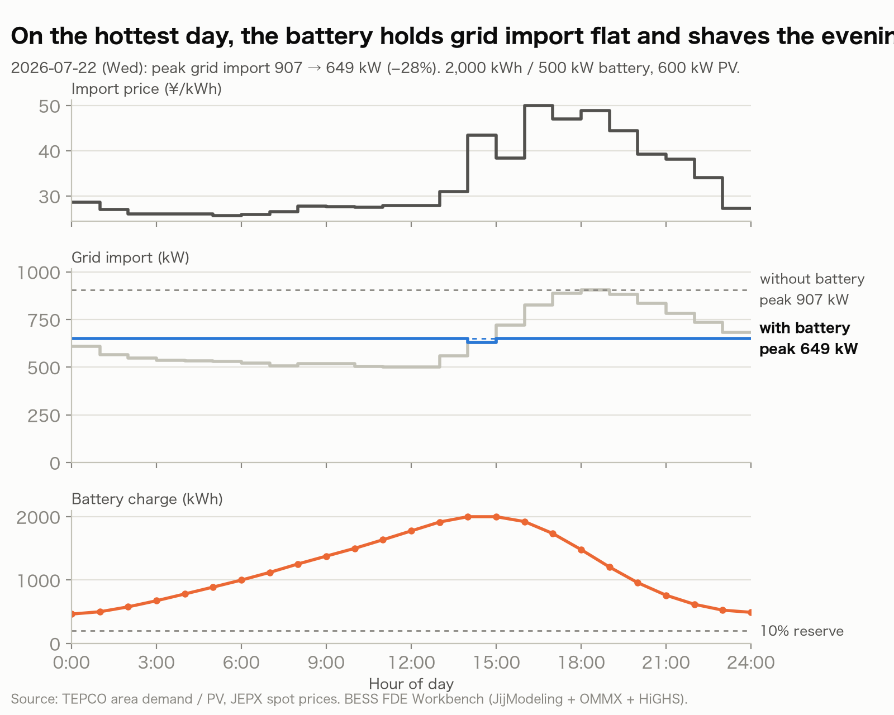
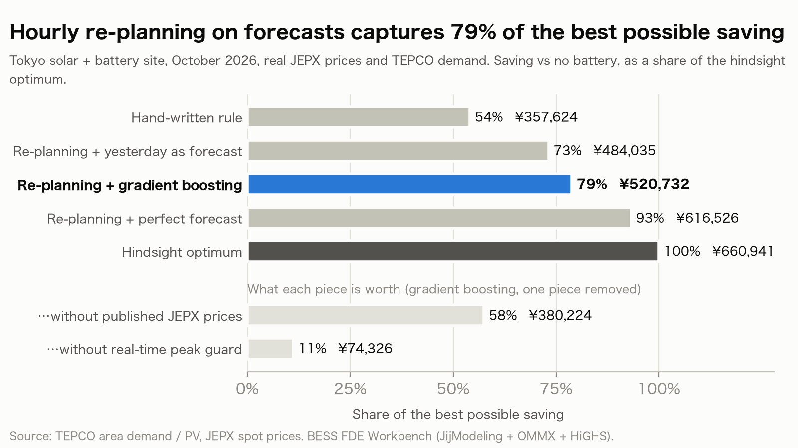

# BESS FDE Workbench

Cost-optimal hourly dispatch for a **commercial solar + battery (BESS) site in Japan**, built on real
TEPCO area demand/solar data and JEPX Tokyo spot prices.

- **Model:** a mixed-integer linear program written once in **JijModeling**, compiled to an **OMMX** instance and
  solved with **HiGHS** or **SCIP**. An independent SciPy model is kept as a cross-check.
- **Measured value:** every schedule is compared with *no battery* and with a *rule-based* operating policy
  using the same cost function.
- **AI harness:** operator alerts in English or Japanese ("台風接近、受電を300kWに制限") are read by **Claude**
  into a typed schema. Deterministic guardrails then clamp every value, and overrides can only *tighten*
  limits. On a 30-case bilingual eval it scores 30/30, against 16/30 for the regex rules. When the limits can't all be met, the optimizer reports
  *which* limit breaks, *when*, and *by how much*, and Claude can explain the trade-off to the operator.
- **Benchmarked:** scaling to 30-min resolution, a quality-vs-time study, and an exact **LP-first** strategy
  that returns the proven MILP optimum about 2.5× faster on real data.
- **Reusable components:** the same six building blocks (`node`, `profile`, `market`, `storage`, `producer`,
  `peak_charge`) describe a battery site *and* a factory's production and inventory plan in YAML. The battery
  site built from blocks gives exactly the hand-written model's optimum; lot sizing matches a Wagner–Whitin DP.
- **Forecasts and rolling re-planning:** gradient-boosting forecasts of load, PV and JEPX price, hourly MPC with
  the month's peak carried between solves, and a real-time peak guard. The study splits the gap to the
  hindsight optimum into forecast error and rolling-horizon loss.
- **Production-ready:** CLI, FastAPI service, Docker image, input checks, structured logging, 120+ tests, a
  model-verification report, Claude Code skills for the team, and GitHub Actions CI.

**Results on April 2026 data** (2,000 kWh / 500 kW battery, 600 kW PV, 1,000 kW peak load):

| Horizon | No battery | Rule-based | **Optimized** | Optimized saving | Peak import |
|---|---|---|---|---|---|
| 1 day | ¥2,093,372 | ¥2,069,871 (−1.1%) | **¥1,860,918** | **−11.1%** | 986 → 827 kW |
| 1 week | ¥5,408,155 | ¥5,279,127 (−2.4%) | **¥5,044,001** | **−6.7%** | 986 → 799 kW |
| 1 month | ¥16,031,682 | ¥15,334,758 (−4.3%) | **¥15,033,602** | **−6.2%** | 986 → 813 kW |

Most of the value comes from **peak shaving**: the rule-based policy never lowers the demand-charge peak,
while the optimizer cuts it by about 17–19%.



---

## 1. The problem

A site has electricity **load**, **solar generation**, a **battery** and a **grid connection**. For every
hour, decide how much to **import / export** and when to **charge / discharge**, to minimize:

```
  Σ_t import_price[t] · import[t] · dt          energy bought
− Σ_t export_price[t] · export[t] · dt          energy sold
+ Σ_t wear_cost · (charge[t] + discharge[t]) · dt   battery degradation
+ demand_charge · max_t import[t]               peak (kW) demand charge
```

subject to:

| Constraint | Meaning |
|---|---|
| `power_balance` | `load + charge + export = solar + discharge + import` every hour |
| `soc_dynamics` | `soc[t+1] = soc[t] + η_ch·charge·dt − discharge·dt/η_dis` |
| `soc_init_eq`, `soc_end_floor` | start at `init_soc_kwh`, finish at or above `end_soc_min_kwh` |
| `soc_min_reserve`, `soc_upper_bound` | reserve floor (default 10%) and ceiling at every state |
| `charge_mode_limit`, `discharge_mode_limit` | a binary `z_ch[t]` prevents charging and discharging in the same hour |
| `grid_import_cap`, export bound | grid connection limits |
| `peak_import_def` | `p_peak ≥ import[t]` (linearizes the max for the demand charge) |

### Strict and elastic in one model

The slack variables `s_soc_min` and `s_imp_cap` are always in the model, and their upper bound is a parameter:

- **strict:** `slack_ub = 0`, so every limit is hard.
- **elastic:** `slack_ub` is large and slack costs ¥10,000/kWh, so the solver breaks limits only when it has to.
  The non-zero slacks show exactly where the scenario is infeasible.

Because the horizon length `T` is also a parameter, **the model is built once** (`build_problem()`, cached) and
reused for every site, horizon and scenario. Only the instance data changes.

---

## 2. Project structure

```
bess-fde-workbench/
├── main.py                        # CLI
├── core_model/
│   ├── formulation.py             # BessParams + JijModeling model + instance data builder
│   ├── solver_runner.py           # backends (OMMX/HiGHS, OMMX/SCIP, SciPy reference), strict → elastic fallback
│   ├── evaluation.py              # cost breakdown, no-battery & rule-based baselines, comparison table
│   ├── data_validation.py         # input checks (columns, gaps, duplicates, NaN, negatives)
│   └── logging_utils.py           # text or JSON structured logs
├── ai_harness/
│   ├── llm_translator.py          # alert → Claude structured extraction → guardrails → overrides
│   ├── exception_translator.py    # regex alert parser (offline baseline + fallback)
│   ├── llm_explainer.py           # Claude-written explanation of limit conflicts
│   ├── diagnostic_agent.py        # results → operator summary
│   └── evals/                     # 30 labelled EN/JA alerts + scorer (run_alert_eval.py)
├── service/
│   ├── pipeline.py                # validate → translate alert → solve → compare (shared by CLI and API)
│   └── api.py                     # FastAPI app: GET /health, POST /optimize
├── data/
│   ├── prepare_japan_grid_data.py # raw TEPCO + JEPX → hourly site CSV
│   ├── april_2026_hourly.csv      # April 2026 (720 h): default for the CLI, API, tests and README numbers
│   ├── april_2026_30min.csv       # same month at 30-min resolution (1,440 steps; benchmarks)
│   ├── japan_2026_hourly.csv      # 1 Apr – 25 Nov 2026 (5,736 h): forecasting and seasonal studies
│   ├── make_factory_demand.py     # synthetic daily demand for the factory example
│   └── raw/                       # TEPCO eria_jukyu (Apr–Nov 2026) + JEPX spot_summary (Jan–Nov 2026)
├── components/                    # reusable building blocks → one JijModeling model per YAML site
│   ├── core.py                    # ModelBuilder: nodes, flow balance, costs
│   ├── library.py                 # node, profile, market, storage, producer, peak_charge
│   └── site.py                    # YAML loading/validation, solve via OMMX (HiGHS / SCIP), per-component costs
├── sites/                         # tokyo_office_bess.yaml, factory_inventory.yaml
├── forecasting/
│   ├── forecasters.py             # persistence, gradient boosting (validated per target), perfect
│   ├── mpc.py                     # hourly rolling re-planning with peak carry-over and peak guard
│   └── run_study.py               # → RESULTS.md: what uncertainty costs
├── benchmarks/                    # run_benchmarks.py → RESULTS.md (scaling, gap/time, LP relaxation)
├── verify.py                      # model verification report (physics, cross-solver, recovery, timing)
├── .claude/skills/                # Claude Code skills: bess-model-verifier, alert-translator-eval, add-component
├── tests/                         # pytest suite
├── Dockerfile, .github/workflows/ci.yml, pyproject.toml, requirements*.txt
```

```
 CSV / API request
        │
        ▼
 data_validation ──► alert translator: rules | Claude + guardrails (optional alert)
        │                       │ overrides
        ▼                       ▼
 make_instance_data ──► JijModeling problem.eval() ──► OMMX Instance ──► HiGHS / SCIP
                                                                            │
         strict infeasible? ──► same model, elastic slack bounds ◄──────────┘
        │
        ▼
 evaluation (vs baselines) ──► diagnostic_agent brief ──► CLI output / JSON response
```

---

## 3. Setup

Python 3.12+ (tested on 3.12–3.14).

```bash
cd bess-fde-workbench
python3 -m venv .venv
source .venv/bin/activate
pip install -r requirements-dev.txt     # or requirements.txt for runtime only
```

---

## 4. Command line

```bash
python main.py                                        # first 24 h
python main.py --start 2026-04-07 --hours 168         # one week
python main.py --hours 720                            # whole month (~1.5 s)
python main.py --solver scip                          # highs (default) | scip | scipy
python main.py --capacity-kwh 3000 --max-charge-kw 750 --max-discharge-kw 750
python main.py --hours 168 --out output/week.csv      # save the hourly schedule
python main.py --log-level INFO --log-json            # structured logs to stderr
python main.py --hours 720 --lp-first                 # exact LP-first speed-up (same optimum)
python main.py --hours 720 --time-limit 2 --mip-gap 0.01   # trade optimality for time
```

Example output:

```
Horizon: 2026-04-01 00:00:00 -> 2026-04-01 23:00:00 (24 h) | Battery 2000 kWh / 500 kW | Solver: highs

Status: OPTIMAL (JijModeling + OMMX / HiGHS, 0.297s) | Objective: ¥1,854,251 | Peak Import: 827.2 kW
Energy: Import 19,473 kWh, Export 0 kWh, Charge 1,100 kWh, Discharge 1,160 kWh

Value vs baselines:
Policy                                 Cost (adj.)   Peak kW    Demand chg       Savings       %
-----------------------------------------------------------------------------------------------
No battery                              ¥2,093,372     986.5    ¥1,381,100            ¥0    0.0%
Rule-based (cheap/expensive hours)      ¥2,069,871     986.5    ¥1,381,100       ¥23,500    1.1%
Optimized (MILP)                        ¥1,860,918     827.2    ¥1,158,011      ¥232,454   11.1%
```

### Operator alerts

```bash
python main.py --alert "Typhoon warning, cap grid import at 300 kW"
```

```
Alert overrides (read by: rules):
  - SoC reserve floor >= 1500.0 kWh for hour indices [0..23]
  - Grid import cap <= 300.0 kW for hour indices [0..23]
  - Applied 75% storm/outage reserve heuristic

Status: STRICT INFEASIBLE (0.303s) — hard constraints conflicted under current inputs.
Elastic Recovery: OPTIMAL (0.254s) | Operational cost (excl. penalties): ¥2,383,220 | Peak Import: 1192.0 kW
Detected constraint conflicts (top items):
  - Grid import cap exceeded by 892.0 kW at 2026-04-01 00:00:00
  - Grid import cap exceeded by 394.9 kW at 2026-04-01 01:00:00
  ...
```

With an alert the baseline comparison is skipped, because the baselines don't model alert overrides and
the comparison wouldn't be like-for-like.

**Who reads the alert** (`--translator`):

| Mode | What happens | Needs |
|---|---|---|
| `rules` (default) | regex/keyword parser. Free, offline, deterministic | nothing |
| `llm` | an LLM extracts the request into a typed schema; code applies the guardrails | an API key (below) |
| `auto` | the LLM, falling back to `rules` on any API error, refusal, bad output or missing key | optional key |

**Which LLM** is picked from the API key you have (`ai_harness/llm_provider.py`):

| Backend | Set | Model |
|---|---|---|
| Claude (Anthropic API) | `ANTHROPIC_API_KEY` | `claude-opus-5-5` unless `LLM_MODEL` is set |
| Any OpenAI-compatible endpoint: OpenAI, Gemini, Azure, vLLM, Ollama, LiteLLM | `LLM_API_KEY` (or `OPENAI_API_KEY` / `GEMINI_API_KEY`), `LLM_BASE_URL` | `LLM_MODEL` (required) |

With several keys set, `LLM_API_KEY` or `LLM_BASE_URL` selects the OpenAI-compatible backend; otherwise
`ANTHROPIC_API_KEY` selects Claude. `LLM_PROVIDER` or `--llm-provider` always overrides the choice.
`GEMINI_API_KEY` on its own implies Google's endpoint, so `LLM_BASE_URL` can be left out.

```bash
# Claude
export ANTHROPIC_API_KEY=sk-ant-...
python main.py --translator llm --alert "停電リスクあり。14時から18時まで予備率70%を確保"

# Gemini (or any OpenAI-compatible endpoint)
export LLM_API_KEY=...                                                     # or GEMINI_API_KEY
export LLM_BASE_URL=https://generativelanguage.googleapis.com/v1beta/openai/
export LLM_MODEL=gemini-2.5-flash
python main.py --translator auto --explain --alert "Typhoon warning, cap grid import at 300 kW"
```

Do not point `ANTHROPIC_BASE_URL` at an OpenAI-compatible endpoint. The Anthropic SDK sends `/v1/messages`
requests, which such endpoints answer with 404. The code detects this and says so.

The OpenAI-compatible backend asks for a JSON-schema response (`response_format`), retries with plain JSON
mode if the endpoint does not support schemas, and validates the reply with the same Pydantic model, so the
guardrails are identical for both backends.

`--explain` adds a short LLM-written note when limits conflict: why they conflict, and the decision the
operator has to make.

What the **rule parser** understands:

| You write | Effect |
|---|---|
| `reserve 80%`, `soc 60%` | SoC floor = % of capacity |
| `reserve 1200 kWh` | SoC floor in kWh |
| `typhoon`, `storm`, `outage`, `台風`, `警報`, `停電` (no number) | SoC floor = 75% of capacity |
| `cap grid import at 300 kW`, `transformer limit 500kw`, `受電 600kW` | import cap |
| `from 14 to 20`, `at 13:00 to 17:00`, `hours14-20` | hour window (index into the horizon; default 0–23) |

It scores 16/30 on the eval set (section 8). Two known gaps are tracked as `xfail` tests: `90% reserve`
(number before the keyword) and `hours 14-20` (with a space).

### All options

| Option | Default | |
|---|---|---|
| `--data` | `data/april_2026_hourly.csv` | hourly input CSV |
| `--start` / `--hours` | first row / 24 | horizon |
| `--alert` | – | operator alert text |
| `--translator` / `--explain` | `rules` / off | how to read `--alert`; LLM explanation of conflicts |
| `--llm-provider` / `--llm-model` | from env keys | `anthropic` or `openai` (any OpenAI-compatible endpoint); model name |
| `--solver` | `highs` | `highs`, `scip`, `scipy` |
| `--lp-first` | off | exact speed-up: accept the LP relaxation when it is MILP-feasible |
| `--mip-gap` / `--time-limit` | solver default / none | stop early (status `FEASIBLE` if the time limit hits) |
| `--no-recovery` / `--no-compare` | off | skip elastic re-solve / baselines |
| `--out` | – | write schedule CSV |
| `--log-level` / `--log-json` | `WARNING` / text | also via `LOG_LEVEL`, `LOG_FORMAT=json` |
| `--capacity-kwh` | 2000 | battery energy |
| `--max-charge-kw` / `--max-discharge-kw` | 500 / 500 | battery power |
| `--init-soc-kwh` / `--end-soc-min-kwh` | 1000 / 800 | start SoC / minimum end SoC |
| `--grid-import-cap-kw` / `--grid-export-cap-kw` | 1200 / 400 | grid limits |
| `--peak-charge-yen-kw` | 1400 | demand charge |
| `--degradation-yen-kwh` | 2.0 | wear cost per kWh throughput |

---

## 5. HTTP API

```bash
uvicorn service.api:app --reload
# interactive docs: http://127.0.0.1:8000/docs
```

```bash
curl -s -X POST localhost:8000/optimize -H 'content-type: application/json' -d '{
  "start": "2026-04-07", "hours": 168,
  "battery": {"capacity_kwh": 3000, "max_charge_kw": 750},
  "solver": "highs",
  "include_schedule": false
}'
```

| Field | Description |
|---|---|
| `start`, `hours` (1–744) | horizon within the data |
| `series` | optional: your own rows `{timestamp, load_kw, solar_kw, import_price_yen_kwh, export_price_yen_kwh}` |
| `battery` | any `BessParams` field; omitted fields use defaults |
| `alert` | operator alert text |
| `translator`, `explain` | `rules` \| `llm` \| `auto`; Claude explanation of conflicts |
| `solver`, `lp_first`, `mip_rel_gap`, `time_limit_sec` | solver backend and quality/time knobs |
| `auto_recover`, `compare`, `include_schedule` | as in the CLI |

The response contains:

- `status`: `OPTIMAL`, `FEASIBLE` (time limit hit, usable schedule), `RECOVERED`, `INFEASIBLE` or `NO_SOLUTION`
- results: `objective_yen`, `mip_gap`, `peak_import_kw`, `schedule` (hourly rows)
- explanation: `brief`, `overrides`, `translator_source`, `violations`, `explanation`
- `comparison`: the cost breakdown per policy

The API server picks the LLM backend from its own environment, as above. With `translator: "llm"` and the LLM unavailable, the API returns **503**. Use `auto` to fall back instead.

If the data fails the input checks, the API returns **422 with every issue found**, not just the first:

```json
{"detail": {"message": "Input data failed validation",
            "issues": ["1 gap(s)/irregular step(s) (expected 1.0 h), first at 2026-01-01 03:00:00",
                       "Column 'load_kw' has 1 negative value(s)"]}}
```

Every response carries an `x-request-id` header. With `LOG_LEVEL=INFO` each request and solve is logged
with its duration, solver, horizon, status and objective.

### Docker

```bash
docker build -t bess-optimizer .
docker run -p 8000:8000 bess-optimizer       # JSON logs, honours $PORT (Cloud Run compatible)
```

---

## 6. Using it from Python

```python
from core_model.formulation import BessParams
from service.pipeline import load_data, select_window, run_scenario

window = select_window(load_data(), start="2026-04-07", hours=168)
result = run_scenario(window, BessParams(capacity_kwh=2500), solver="highs")

print(result.brief)
print(result.comparison[["adjusted_cost_yen", "peak_import_kw", "savings_pct"]])
schedule = result.schedule_frame()  # pandas DataFrame, one row per hour
```

Lower level:

```python
from core_model.formulation import build_problem, make_instance_data
from core_model.solver_runner import solve_dispatch

problem = build_problem()  # jm.Problem (renders as LaTeX in Jupyter)
instance = problem.eval(make_instance_data(window, BessParams()))  # ommx.v1.Instance
strict, recovery = solve_dispatch(window, BessParams(), solver="scip")
```

---

## 7. How savings are measured

All policies are scored by `core_model/evaluation.py` with the optimizer's cost function (slack penalties excluded):

- **No battery:** solar and grid only. Surplus PV is exported up to the export cap, then curtailed.
- **Rule-based:** what a site typically runs without an optimizer. Per day it charges in the 6 cheapest hours
  (without pushing import above the existing peak), discharges to cover load in the 6 most expensive hours,
  and always stores surplus solar.
- **Optimized:** the MILP schedule.

**Stored-energy adjustment:** a policy that ends the horizon with less energy than it started with has used
"free" stored energy. The change in SoC is valued at the horizon's average import price × discharge efficiency
and added to the cost, so policies are compared like-for-like.

---

## 8. AI harness: design and evaluation

### Claude extracts, code decides

`ai_harness/llm_translator.py` calls Claude Opus 5.5 (`claude-opus-5-5`, low effort) with **structured outputs**:
`client.beta.messages.parse(output_format=AlertExtraction)`. The schema has explicit reserves, import caps, end-of-horizon
SoC, a storm/outage flag, and a `not_applied` list for requests that have no matching control. Server-side
refusal fallback (`fallbacks="default"`) is on.

Everything that touches the physical schedule is decided by `extraction_to_patch`, not by the model:

| Rule | Why |
|---|---|
| Hours are clamped into the horizon, reversed windows are swapped, out-of-horizon requests are dropped with a note | a misread time can't break the instance |
| `0 ≤ reserve ≤ capacity`, `0–100 %`, caps `≥ 0` | a reserve above capacity would make every schedule infeasible |
| The 75% storm reserve is site policy applied in code; the model only flags the risk | policy changes are code reviews, not prompt edits |
| Overrides can only **tighten** limits (max for floors, min for caps, never lower the end-SoC floor) | a bad extraction can make the schedule more conservative, never less safe |
| Requests with no matching control are shown as "Not applied: …" | nothing is dropped silently |
| `auto` mode falls back to rules on API errors, refusals, truncation or a missing key | the optimizer never blocks on the LLM |

### Evaluation

`ai_harness/evals/alert_cases.jsonl` holds 30 labelled alerts in English and Japanese. They cover clock windows,
MW→kW, end-of-horizon requests, two windows in one alert, clamping, storm policy, out-of-scope requests, and
"no action needed". A case passes only if every override matches.

```bash
python -m ai_harness.evals.run_alert_eval --mode rules     # offline baseline
python -m ai_harness.evals.run_alert_eval --mode llm --out ai_harness/evals/results_llm.json   # ~30 calls to the configured LLM
python -m ai_harness.evals.run_alert_eval --mode llm --provider openai --model gemini-2.5-flash  # compare another model
```

| Translator | Accuracy | Notes |
|---|---|---|
| Rule parser | **16/30 (53%)** | fails on clock windows, Japanese windows, MW, end-of-horizon SoC, number-before-keyword |
| **Claude Opus 5.5 + guardrails** | **30/30 (100%)** | all fields correct, English and Japanese; 55 s, about $0.31 for the run ([results](ai_harness/evals/results_llm_claude.json)) |

All Claude-path tests run offline with a fake client (`tests/test_llm_harness.py`): request shape, guardrails,
every fallback path, only-tighten behaviour, and a check that the eval labels agree with the code policy.

### Harness for the development team

- **`verify.py`**: one command that checks power balance, SoC dynamics, the mode lock, that every backend proves
  the same optimal cost (MIP gap 1e-9), and infeasibility recovery, with timings. Exit code 1 on any failure.
- **`.claude/skills/bess-model-verifier`**: tells Claude Code to run `verify.py` and the tests after any model
  change, and how to diagnose each kind of failure.
- **`.claude/skills/alert-translator-eval`**: the design rules above, plus the measure-before-and-after
  workflow for changing the prompt, schema, rules or eval cases.

---

## 9. Reusable components: one library, many sites

Every new customer should be a **configuration**, not a new model. `components/` provides six building
blocks; each one adds its own data, variables, flows, constraints and costs to one JijModeling problem,
and every `node` gets a balance constraint (flows in = flows out, at every step).

```bash
python -m components sites/tokyo_office_bess.yaml --steps 24 --show battery.level grid.buy
python -m components sites/factory_inventory.yaml --show line.output warehouse.level supplier.buy
```

```yaml
# sites/tokyo_office_bess.yaml (excerpt)
components:
  - {type: node, name: bus}
  - {type: profile, name: load, node: bus, direction: out, column: load_kw}
  - {type: profile, name: pv, node: bus, direction: in, column: solar_kw}
  - {type: market, name: grid, node: bus, buy_price: import_price_yen_kwh, sell_price: export_price_yen_kwh,
     buy_limit: 1200, sell_max: 400}
  - {type: storage, name: battery, node: bus, capacity: 2000, max_in: 500, max_out: 500, eff_in: 0.94,
     eff_out: 0.94, initial: 1000, final_min: 800, floor: 200, throughput_cost: 2.0, exclusive_modes: true}
  - {type: peak_charge, name: demand_charge, flow: grid.buy, rate: 1400}
```

**The same blocks, a different industry.** A battery's state of charge and a warehouse's inventory follow
the same equation, `level[t+1] = level[t] + eff_in·in[t]·dt − out[t]·dt/eff_out`. A battery's
charge/discharge mode lock and a production setup are the same binary pattern.

| Block | Battery site | Factory (`sites/factory_inventory.yaml`, one step = one day) |
|---|---|---|
| `node` | site electrical bus | finished-goods stock point |
| `profile` | load (out), PV (in) | customer demand, with a lost-sales penalty |
| `market` | grid import/export at JEPX prices | contract supplier, 80 units/day |
| `storage` | battery: SoC, efficiency, wear, reserve floor | warehouse: holding cost, safety stock |
| `producer` | (a generator with a start cost) | production line: setup cost, minimum run, overtime pay on weekends and Golden Week |
| `peak_charge` | demand charge on peak import | capacity fee on the peak supplier volume |

In the factory plan the line runs in batches to save setups, and stock builds up before Golden Week.

**How we know it is right**
- **Same optimum as the original model.** The battery site built from blocks gives the hand-written
  `core_model` model's optimum to 1e-8 for a day and a week, on HiGHS and SCIP, including a rolling state
  (measured SoC plus the peak so far).
- **Independent check.** Uncapacitated lot sizing built from the blocks matches an exact Wagner–Whitin
  dynamic program on random instances.
- **Factory physics.** Balance, inventory dynamics, setup logic and the cost breakdown are each tested.
- **Config errors are specific.** A wrong type, an unknown field, a dangling node or flow reference, a missing
  column or a duplicate name names the component and the field at fault.

The `add-component` Claude Code skill (`.claude/skills/add-component`) explains how to add a block, and which
tests it needs, without breaking these guarantees.

## 10. Forecasts and rolling re-planning

The optimizer above knows the future: load, PV and prices for the whole horizon. A real site doesn't.
`forecasting/` simulates what it does instead, hour by hour, settled against **actual** data:

1. **Forecast** the next 24 h from data strictly before now. The JEPX price is used wherever the day-ahead
   auction has already published it (by 10:00 the day before); only the unknown hours are forecast.
2. **Plan** with the same MILP, starting from the *measured* SoC and carrying the **month's peak import so
   far** (`prior_peak_kw`). Raising the peak costs the demand charge; staying below it is free.
3. **Apply the first hour only.** A real-time **peak guard** cuts charging, then adds discharge, if actual
   import would exceed the planned peak. The grid absorbs the rest of the forecast error.
4. Move on one hour and re-plan.

```bash
python -m forecasting.run_study                         # October 2026, 744 re-plans per policy, HiGHS (~17 min)
python -m forecasting.run_study --solver scipy          # same in ~3 min
python -m forecasting.run_study --test-start 2026-08-01 --days 7
```

**Forecasters** (`forecasting/forecasters.py`): *persistence* (same hour yesterday) and *gradient boosting*
(scikit-learn `HistGradientBoostingRegressor`, the LightGBM algorithm). Gradient boosting uses lead, hour,
day of week, Japanese holidays / Obon / New Year, the day-after-a-holiday flag, and lags of 24, 48 and 168 h.
Each target's model predicts the **correction to persistence**, and is used only if it beats persistence on a
held-out last two weeks of training. A forecaster cannot see the future by construction; a test changes all
data after the forecast origin and checks the forecast does not move.



**October 2026** (one billing month; trained on April–September site data and January–September JEPX prices;
full table in [`forecasting/RESULTS.md`](forecasting/RESULTS.md)):

| Policy | Cost | Saving vs no battery | Share of hindsight saving | Peak import |
|---|---|---|---|---|
| No battery | ¥11,798,656 | — | 0% | 637 kW |
| Rule-based | ¥11,441,032 | ¥357,624 | 54% | 637 kW |
| MPC + persistence | ¥11,314,621 | ¥484,035 | 73% | 588 kW |
| **MPC + gradient boosting** | **¥11,277,924** | **¥520,732** | **79%** | 569 kW |
| MPC + perfect forecast | ¥11,182,129 | ¥616,526 | 93% | 490 kW |
| Hindsight optimum (one solve) | ¥11,137,714 | ¥660,941 | 100% | 474 kW |
| *Ablation:* gradient boosting, JEPX prices forecast too | ¥11,418,431 | ¥380,224 | 57% | 569 kW |
| *Ablation:* gradient boosting, no peak guard | ¥11,724,330 | ¥74,326 | 11% | 943 kW |

What it shows:
- **The real-time peak guard is worth more than any forecast.** Without it, forecast error creates new monthly
  peaks (943 kW) and the battery saves almost nothing. A planner on its own is not a controller.
- **Use the market's own information.** Using the published JEPX day-ahead prices instead of forecasting them
  is worth ¥140,507 in the month; 92% of the price-hours in a 24 h plan are already published. In October gradient boosting forecasts the price *worse* than persistence
  (prices rose sharply after the validation window), which is exactly when knowing the auction result matters.
- **The remaining gap is split in two.** Forecast error costs ¥95,795 (gradient boosting vs perfect forecast);
  the 24 h rolling horizon and its terminal reserve cost ¥44,415 (perfect forecast vs hindsight). Most of the
  forecast error shows up as a higher monthly peak (569 vs 490 kW).
- **Better accuracy is not automatically better decisions.** In short tests the forecaster with the lower MAE
  sometimes made the costlier plan, because one bad hour at the peak costs more than many small errors.
  Evaluate forecasts by the cost of the decisions they drive, not only by MAE.

**Forecast accuracy in October** (raw forecasts, all leads 0–23 h, every hour):

| Forecaster | MAE load | MAE PV | MAE JEPX price | Skill load | Skill PV | Skill price |
|---|---|---|---|---|---|---|
| Persistence | 31.3 kW | 36.9 kW | ¥3.84 | — | — | — |
| Gradient boosting | 15.3 kW | 37.2 kW | ¥4.85 | **+51%** | −1% | −26% |

The holiday features carry the load forecast (October 12 is Sports Day). PV without a weather forecast
is no better than yesterday. MPC costs can differ by a few tens of yen between runs, because HiGHS may return
a different one of several equally optimal plans.


## 11. Verification, tests and benchmarks

```bash
pytest                      # ~15 s, offline
python verify.py            # model verification report
ruff check . && ruff format --check .
python benchmarks/run_benchmarks.py    # ~2 min → benchmarks/RESULTS.md
```

| Test file | What it checks |
|---|---|
| `test_formulation.py` | power balance, SoC dynamics and bounds, no simultaneous charge/discharge, power limits, zero slack when strict |
| `test_solver_agreement.py` | HiGHS, SCIP and the SciPy reference prove the **same optimal cost** (normal, week-long, infeasible) |
| `test_solver_options.py` | LP-first is exact (and falls back when the LP cheats), time limits, gaps, LP lower bound |
| `test_recovery.py` | infeasible scenario → elastic recovery with located violations |
| `test_evaluation.py` | baselines obey physics, the rule never raises the peak, the optimizer beats both, cost breakdown = solver objective |
| `test_data_validation.py` | missing columns, gaps, duplicates, NaN, negatives (all reported at once) |
| `test_exception_translator.py`, `test_llm_harness.py`, `test_llm_providers.py` | rule parser, Claude and OpenAI-compatible paths with fake clients, backend selection, eval set integrity |
| `test_api.py`, `test_cli.py` | end-to-end through FastAPI and the CLI |

**Bugs the verification caught:**

- **Swapped signs in the original SciPy model.** When the JijModeling model was introduced, its results
  disagreed with the hand-built SciPy model. Checking each solution against the physics showed the SciPy power
  balance had the charge and discharge signs swapped, and earlier results from it were wrong.
- **A false "disagreement" from the default MIP gap.** `verify.py` later flagged a 0.006% difference at one
  month. HiGHS stops at its default 1e-4 MIP gap, so verification now asks every solver to *prove* optimality.

CI (`.github/workflows/ci.yml`) runs these jobs:

1. Lint.
2. On Python 3.12, 3.13 and 3.14: the tests, `verify.py --quick`, the rule-parser eval and a CLI smoke test.
3. Docker: build the image and call `/optimize` on the running container.

### Benchmark findings

Full tables are in [`benchmarks/RESULTS.md`](benchmarks/RESULTS.md) (April 2026, Apple Silicon laptop):

- **Scaling.** A month at 30-min resolution (1,440 steps and binaries) solves in about 1.2–1.6 s on every
  backend. About 0.5 s of the OMMX path is fixed overhead (JijModeling compile ≈ 0.25–0.3 s, HiGHS model
  build ≈ 0.23 s), which dominates short horizons.
- **Quality vs time.** Relaxing the MIP gap or setting tight time limits saves under a second but costs
  0.03–1.1% (up to ¥168k/month). These instances solve quickly enough that the default settings are the
  right choice.
- **Are the binaries needed?** On the real Tokyo data the LP relaxation has the *same* optimum as the MILP
  (integrality gap 0, no step charges and discharges at once). Round-trip losses and wear cost make burning
  energy unprofitable, and even at negative prices the MILP can burn energy almost as well by alternating
  charge and discharge across steps. The LP only "cheats" in a stress case (negative prices *and* zero
  wear cost: 9 simultaneous steps, 0.001% gap).
- **LP-first (exact).** Solve the LP. If its schedule never charges and discharges at once, it is MILP-feasible
  and therefore MILP-optimal. Otherwise solve the MILP. On real data this returns the proven optimum
  **2.4–2.5× faster**, and in the stress case it correctly falls back.
- **Upstream performance bug found.** `ommx-highs-adapter`'s `decode()` reads `solution.col_value[i]` in a loop.
  highspy copies the whole vector on each access, so decoding is O(n²): 1.7 s for 11.5k variables, 13× the LP
  solve. The workbench reads the vector once (0.04 s). Worth reporting to the OMMX project.

---

## 12. Rebuilding the dataset

```bash
python data/prepare_japan_grid_data.py      # every TEPCO file in data/raw -> data/japan_2026_hourly.csv
APRIL=data/raw/eria_jukyu_202604_03.csv
python data/prepare_japan_grid_data.py --area-csv $APRIL --out-csv data/april_2026_hourly.csv
python data/prepare_japan_grid_data.py --area-csv $APRIL --freq 30min --out-csv data/april_2026_30min.csv
python data/prepare_japan_grid_data.py --start-date 2026-08-01 --days 7 --out-csv data/week.csv
```

- **Load:** TEPCO area demand, hourly, scaled so the *period's* peak = 1,000 kW. Over April–November the peak is
  in the July heatwave, so the seasonal shape is kept: April loads peak near 600 kW, July at 1,000 kW.
- **Solar:** TEPCO area PV output, scaled so the period's peak = 600 kW.
- **Files:** TEPCO has published the monthly files in UTF-8 (April–June) and Shift-JIS (July onward); both are read.
  Only complete days are kept, because the newest month usually stops mid-day.
- **Import price:** JEPX Tokyo area price (30-min slots → hourly) + wheeling fee (default ¥8.5/kWh).
- **Export price:** `min(0.7 × Tokyo price, ¥10/kWh)`.

To use your own site, pass a CSV with `timestamp, load_kw, solar_kw, import_price_yen_kwh, export_price_yen_kwh`
via `--data`, or send rows as `series` to the API.

---

## 13. [WIP]

- **Forecasts.** Load and PV come from scaled TEPCO *area* curves, not a metered site, and there is no
  weather forecast, so PV is hard to beat with persistence. Next: a weather API feature (irradiance, temperature),
  and quantile forecasts with a reserve sized to forecast uncertainty instead of a fixed peak guard.
- **Demand charge.** Re-planning carries the month's peak between solves (`prior_peak_kw`), but Japanese
  基本料金 is set by the highest **30-minute** demand over the last **12 months**. Next: 30-min re-planning (the
  model already runs at `dt_hours=0.5`; the simulator is hourly) and a 12-month ratchet.
- **Small eval set.** 30 cases is enough to separate the rule parser (53%) from Claude (100%), not to measure
  rare failure modes. Next: grow it from real operator messages, and record each model's results so
  regressions show up case by case.
- **Fixed OMMX overhead (~0.5 s per solve).** This matters for many short solves (e.g. a fleet of sites); caching
  the compiled instance and updating only the data would remove most of it.
- **Baselines with alerts.** The baselines don't model alert overrides, so the comparison is skipped when an
  alert is applied.
