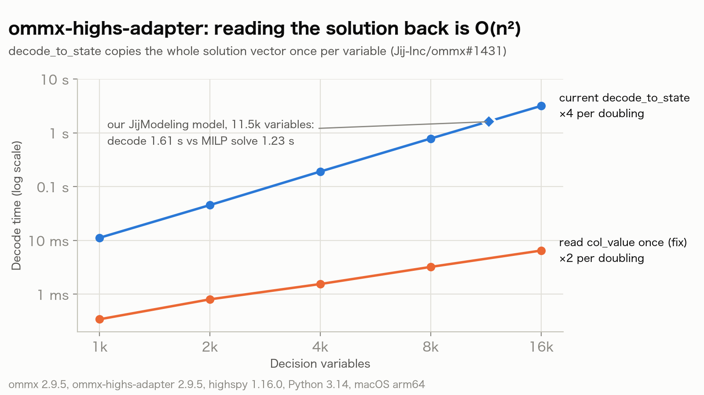

# ommx-highs-adapter: `decode_to_state` is O(n²)

**概要:** `OMMXHighsAdapter.decode_to_state` はループ内で毎回 `solution.col_value[i]` を読み出しています。highspy は
`col_value` を読むたびに解ベクトル全体を新しい Python リストへコピーするため、デコードが変数数 n に対して O(n²) になります。
ベクトルを一度だけ取得すれば O(n) になり、結果は同一です。本プロジェクトの実モデル（約 1.15 万変数）では、
デコード（1.68 秒）が HiGHS の求解（1.18 秒）より長くかかっていました。

| | |
|---|---|
| Package | `ommx-highs-adapter` (OMMX, Jij Inc.) |
| Affected | 2.9.5 (installed here) and current `main` (commit `f1b3dd0`, checked 2026-11-26) |
| Code | [`adapter.py` L1185–L1191 on main](https://github.com/Jij-Inc/ommx/blob/f1b3dd06ea4e447a85fd95bdb9d5ddc3f983d696/python/ommx-highs-adapter/ommx_highs_adapter/adapter.py#L1185-L1191) |
| Impact | Decoding time grows with n²: 3.1 s at 16k variables, ~12 s at 32k, ~50 s at 64k (extrapolated) |
| Fix | Read `col_value` once (one line); values are identical |
| Upstream issue | [Jij-Inc/ommx#1431](https://github.com/Jij-Inc/ommx/issues/1431) (no earlier issue or PR found) |



## Environment

ommx 2.9.5, ommx-highs-adapter 2.9.5, highspy 1.16.0 (HiGHS 1.16.0), jijmodeling 2.12.1, Python 3.14.10, macOS arm64.

## The code

```python
# ommx_highs_adapter/adapter.py, OMMXHighsAdapter.decode_to_state (2.9.5; main is the same but iterates
# self.instance.active_decision_variables)
solution = data.getSolution()
return State(entries={var.id: solution.col_value[i] for i, var in enumerate(self.instance.used_decision_variables)})
```

`decode()` calls `decode_to_state()` first, so the public `decode()` API is affected too.

## Root cause

`highspy.HighsSolution.col_value` is a pybind11 property backed by a `std::vector<double>`. Every read converts
the whole vector into a **new** Python list:

```python
s = h.getSolution()
type(s.col_value)  # list
s.col_value is s.col_value  # False: two reads, two copies
```

Measured on a 16,000-column model: one read of `col_value` takes 0.29 ms. The comprehension reads it once per
variable, so decoding makes n full copies of an n-element vector, which is O(n²) time.

## Reproduce

From the repository root, with the project's virtual environment (`pip install -r requirements.txt`):

```bash
python reports/ommx-highs-decode/repro_minimal.py      # OMMX + HiGHS only, no JijModeling
python reports/ommx-highs-decode/repro_bess_model.py   # the real JijModeling model where we hit it
```

### 1. Minimal (`repro_minimal.py`)

n continuous variables in [0, 1], maximise their sum, no constraints. It times `decode_to_state` against the
single-copy version and asserts both return identical values.

```
n=  2000  decode_to_state   0.045s   single-copy  0.0009s   (50x)
n=  4000  decode_to_state   0.187s   single-copy  0.0017s   (109x)
n=  8000  decode_to_state   0.780s   single-copy  0.0040s   (197x)
n= 16000  decode_to_state   3.108s   single-copy  0.0201s   (155x)
```

Each doubling of n makes decoding about **4× slower** (quadratic); the fixed version grows linearly.

### 2. As it happened in this project (`repro_bess_model.py`)

The battery dispatch MILP from `core_model/formulation.py`, one month (April 2026) at 30-min resolution, built with
JijModeling and evaluated to an OMMX instance exactly as the application does:

```
Model: 1440 steps at 30 min, 11,523 decision variables, 11,524 rows
  JijModeling eval -> OMMX instance     0.437 s
  HiGHS run (MILP)                      1.183 s   objective 14,929,991
  adapter.decode(model)                 1.675 s
    of which decode_to_state            1.632 s
  single copy of col_value (fix)       0.0092 s   -> 177x faster, same values
```

Reading the solution took **longer than solving the MILP**. For a month at 30-min resolution, the resolution
Japanese demand charges are billed at, the adapter more than doubled the end-to-end time.

## Suggested fix

```python
col_value = data.getSolution().col_value  # one copy
return State(entries={var.id: col_value[i] for i, var in enumerate(self.instance.active_decision_variables)})
```

Both reproductions assert that this returns exactly the same `State.entries` as the current code. It is
worth checking other adapters for the same pattern: indexing a pybind11 vector property inside a loop.

## Workaround in this project

`core_model/solver_runner.py::_values_from_highs` reads `h.getSolution().col_value` once and maps it with
`instance.used_decision_variables` (the order the adapter creates its columns in). That took decoding from 1.7 s
to 0.04 s for the 30-min month and is covered by the cross-solver tests (`tests/test_solver_agreement.py`, `verify.py`).

## Upstream issue

Filed as [Jij-Inc/ommx#1431](https://github.com/Jij-Inc/ommx/issues/1431) on 2026-11-26, with the minimal
reproduction, the real-model timings and the one-line fix.
